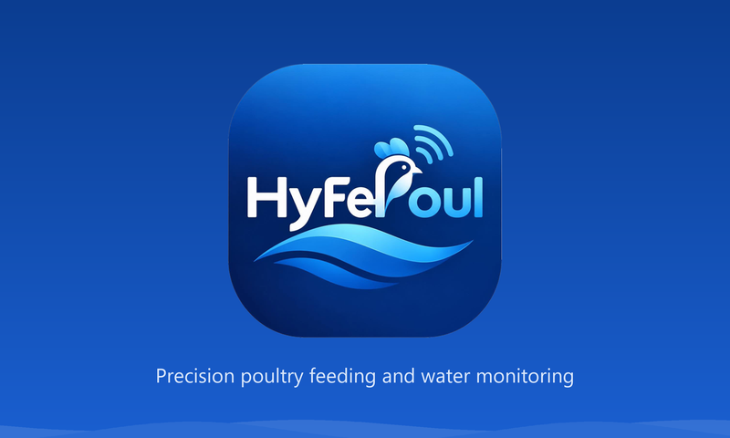
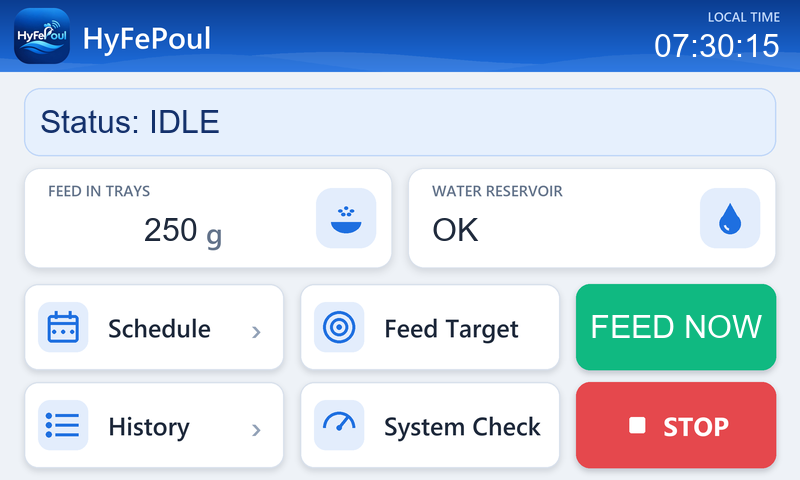
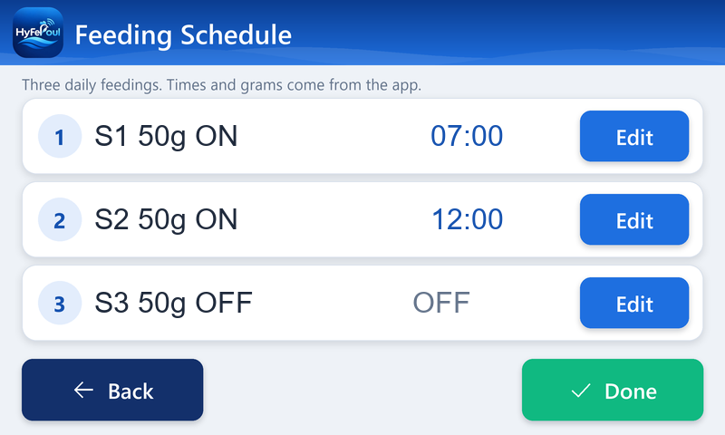
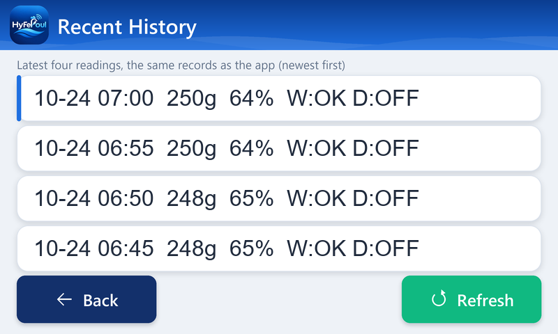
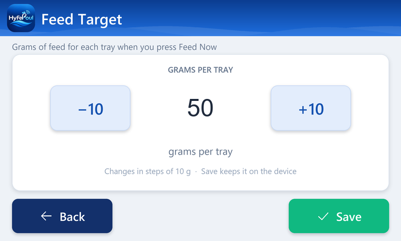
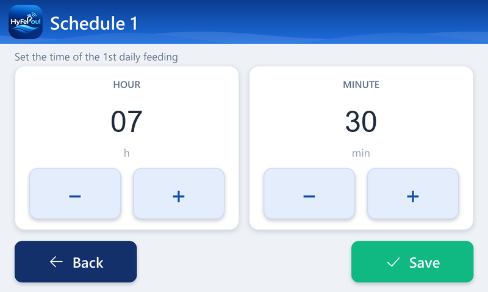
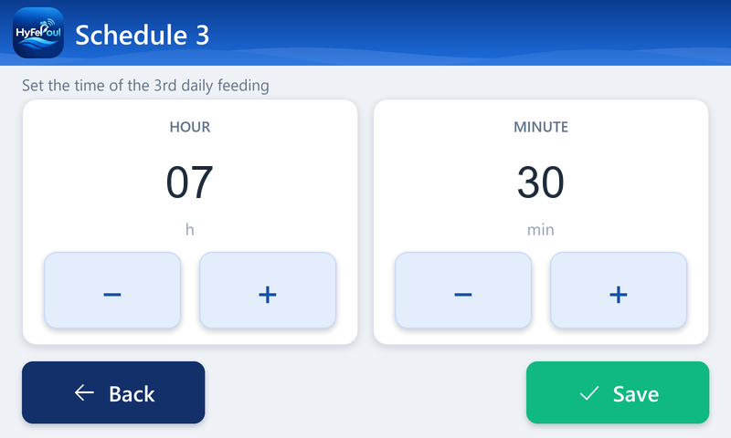
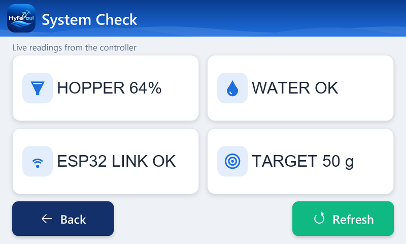

# Applying the HyFePoul design in Nextion Editor

This restyles the panel without changing how it works. **No component is added, deleted or renamed**, so every page ID and component ID the Mega uses (`Nextion_IDs.txt`) stays the same. Only positions, sizes, colours and backgrounds change.

Time: about 45-60 minutes. Panel: NX8048P070 (800x480).

## 0. Before you start

1. **Back up** `Nextion/HyFePoul.hmi` (copy it as `HyFePoul_before-design.hmi`).
2. Open `HyFePoul.hmi` in Nextion Editor.
3. Keep the mockups in `mockups/` open beside the Editor; each page should end up looking like its mockup.

## 1. Import the pictures (once)

In the **Picture** panel (bottom left), click **+** and add these files from `design-kit/images/`, **in this order**. The project already has pictures 0-2, so they get IDs 3-20. Check the IDs in the Picture panel after importing; if any differ, use the IDs the Editor shows in the steps below.

| Picture ID | File |
|---|---|
| **3** | `03_Logo_normal.png` |
| **4** | `04_Logo_center.png` |
| **5** | `05_Home_normal.png` |
| **6** | `06_Home_pressed.png` |
| **7** | `07_Sched_normal.png` |
| **8** | `08_Sched_pressed.png` |
| **9** | `09_Log_normal.png` |
| **10** | `10_Log_pressed.png` |
| **11** | `11_Grams_normal.png` |
| **12** | `12_Grams_pressed.png` |
| **13** | `13_Sched1_normal.png` |
| **14** | `14_Sched1_pressed.png` |
| **15** | `15_Sched2_normal.png` |
| **16** | `16_Sched2_pressed.png` |
| **17** | `17_Sched3_normal.png` |
| **18** | `18_Sched3_pressed.png` |
| **19** | `19_SystemCheck_normal.png` |
| **20** | `20_SystemCheck_pressed.png` |

## 2. How each kind of component is set

Select a component, then change these in the **Attribute** panel (right side):

| Kind | sta | Pictures | Text |
|---|---|---|---|
| **Page** (click empty space) | `image` | `pic` = the page's *normal* picture | - |
| **Button** | `crop image` | `picc` = normal, `picc2` = pressed | `txt` = empty (the label is in the picture), except Home `b4` |
| **Text / number the Mega writes** ("live") | `crop image` | `picc` = normal | keep `txt`; set `pco`, `xcen`, `ycen` = 1 (Center) |
| **Fixed caption** ("caption") | `crop image` | `picc` = normal | `txt` = empty (the caption is in the picture) |

Then set `x`, `y`, `w`, `h` exactly as in the page table. Colours in the tables are given as hex and as the Nextion decimal value (RGB565) to type into `pco` / `pco2`. Leave `font` as it is (0 = Arial 32 px) unless you do the optional font step at the end.

> **Do not delete** components that become invisible (captions with empty text). Deleting renumbers the IDs after it and breaks the Mega's buttons.

## 3. Page by page

### Page 0 - Logo

**Page:** `sta` = image, `pic` = **3**.

**p0** (picture, ID 2): `pic` = **4**, keep x=160 y=0 w=480 h=480. It is the centre of the splash, so the logo sits seamlessly on the background.

### Page 1 - Home

**Page:** `sta` = image, `pic` = **5**.

| Component | ID | Kind | x | y | w | h | Pictures | Text | pco (hex / decimal) | xcen |
|---|---|---|---|---|---|---|---|---|---|---|
| `t0` | 1 | text, caption | 48 | 176 | 200 | 24 | picc=5 | empty | - | - |
| `t1` | 2 | text, caption | 432 | 176 | 200 | 24 | picc=5 | empty | - | - |
| `t2` | 3 | text, live | 48 | 206 | 150 | 48 | picc=5 | *keep* | #1E293B / 6471 | Right |
| `t3` | 4 | text, live | 432 | 206 | 320 | 48 | picc=5 | *keep* | #1E293B / 6471 | Left |
| `b0` | 5 | button | 24 | 284 | 260 | 86 | picc=5, picc2=6 | empty | - | - |
| `b1` | 6 | button | 24 | 382 | 260 | 86 | picc=5, picc2=6 | empty | - | - |
| `b2` | 7 | button | 300 | 284 | 260 | 86 | picc=5, picc2=6 | empty | - | - |
| `b3` | 8 | button | 576 | 382 | 200 | 86 | picc=5, picc2=6 | empty | - | - |
| `b4` | 9 | button, live label | 576 | 284 | 200 | 86 | picc=5, picc2=6 | *keep* (Mega writes it) | #FFFFFF / 65535 (also pco2) | Center |
| `t4` | 10 | text, live | 40 | 96 | 720 | 52 | picc=5 | *keep* | #13306B / 4493 | Left |
| `t5` | 11 | text, live | 620 | 26 | 160 | 40 | picc=5 | *keep* | #FFFFFF / 65535 | Right |
| `t6` | 12 | text, caption | 620 | 6 | 160 | 20 | picc=5 | empty | - | - |
| `t7` | 13 | text, caption | 200 | 212 | 40 | 40 | picc=5 | empty | - | - |
| `b5` | 14 | button | 300 | 382 | 260 | 86 | picc=5, picc2=6 | empty | - | - |

Home notes: `b4` keeps its text because the Mega changes it (FEED NOW / FEEDING / RESET STOP); set its `pco` and `pco2` to white. `t5` is the clock in the header, so its `pco` is white too.

### Page 2 - Sched

**Page:** `sta` = image, `pic` = **7**.

| Component | ID | Kind | x | y | w | h | Pictures | Text | pco (hex / decimal) | xcen |
|---|---|---|---|---|---|---|---|---|---|---|
| `b0` | 1 | button | 24 | 396 | 200 | 68 | picc=7, picc2=8 | empty | - | - |
| `t0` | 2 | text, caption | 0 | 0 | 800 | 72 | picc=7 | empty | - | - |
| `t1` | 3 | text, live | 104 | 130 | 300 | 40 | picc=7 | *keep* | #1E293B / 6471 | Left |
| `t2` | 4 | text, live | 104 | 222 | 300 | 40 | picc=7 | *keep* | #1E293B / 6471 | Left |
| `t3` | 5 | text, live | 104 | 314 | 300 | 40 | picc=7 | *keep* | #1E293B / 6471 | Left |
| `b1` | 6 | button | 640 | 122 | 120 | 56 | picc=7, picc2=8 | empty | - | - |
| `b3` | 7 | button | 640 | 306 | 120 | 56 | picc=7, picc2=8 | empty | - | - |
| `t4` | 8 | text, live | 430 | 126 | 90 | 48 | picc=7 | *keep* | #1552B0 / 4758 | Right |
| `b4` | 9 | button | 576 | 396 | 200 | 68 | picc=7, picc2=8 | empty | - | - |
| `t7` | 10 | text, live | 520 | 126 | 70 | 48 | picc=7 | *keep* | #1552B0 / 4758 | Left |
| `t5` | 11 | text, live | 430 | 218 | 90 | 48 | picc=7 | *keep* | #1552B0 / 4758 | Right |
| `t6` | 12 | text, live | 520 | 218 | 70 | 48 | picc=7 | *keep* | #1552B0 / 4758 | Left |
| `t8` | 13 | text, live | 430 | 310 | 90 | 48 | picc=7 | *keep* | #64748B / 25521 | Right |
| `t9` | 14 | text, live | 520 | 310 | 70 | 48 | picc=7 | *keep* | #1552B0 / 4758 | Left |
| `b2` | 15 | button | 640 | 214 | 120 | 56 | picc=7, picc2=8 | empty | - | - |

Schedule notes: `t1`-`t3` show "S1 50g ON" and the times show "07:" / "00", all written by the Mega. The hour fields (`t4`, `t5`, `t8`) are right-aligned so they meet the minute fields (`t7`, `t6`, `t9`).

### Page 3 - Log

**Page:** `sta` = image, `pic` = **9**.

| Component | ID | Kind | x | y | w | h | Pictures | Text | pco (hex / decimal) | xcen |
|---|---|---|---|---|---|---|---|---|---|---|
| `b0` | 1 | button | 24 | 396 | 200 | 68 | picc=9, picc2=10 | empty | - | - |
| `t0` | 2 | text, caption | 0 | 0 | 800 | 72 | picc=9 | empty | - | - |
| `t1` | 3 | text, live | 48 | 118 | 712 | 46 | picc=9 | *keep* | #1E293B / 6471 | Left |
| `b1` | 4 | button | 576 | 396 | 200 | 68 | picc=9, picc2=10 | empty | - | - |
| `t2` | 5 | text, live | 48 | 190 | 712 | 46 | picc=9 | *keep* | #1E293B / 6471 | Left |
| `t3` | 6 | text, live | 48 | 262 | 712 | 46 | picc=9 | *keep* | #1E293B / 6471 | Left |
| `t4` | 7 | text, live | 48 | 334 | 712 | 46 | picc=9 | *keep* | #1E293B / 6471 | Left |

### Page 4 - Grams

**Page:** `sta` = image, `pic` = **11**.

| Component | ID | Kind | x | y | w | h | Pictures | Text | pco (hex / decimal) | xcen |
|---|---|---|---|---|---|---|---|---|---|---|
| `b0` | 1 | button | 24 | 396 | 200 | 68 | picc=11, picc2=12 | empty | - | - |
| `t0` | 2 | text, caption | 0 | 0 | 800 | 72 | picc=11 | empty | - | - |
| `n0` | 3 | number, live | 300 | 170 | 200 | 90 | picc=11 | *keep* | #1E293B / 6471 | Center |
| `b3` | 4 | button | 576 | 396 | 200 | 68 | picc=11, picc2=12 | empty | - | - |
| `b1` | 5 | button | 540 | 170 | 160 | 90 | picc=11, picc2=12 | empty | - | - |
| `b2` | 6 | button | 100 | 170 | 160 | 90 | picc=11, picc2=12 | empty | - | - |

### Page 5 - Sched1

**Page:** `sta` = image, `pic` = **13**.

| Component | ID | Kind | x | y | w | h | Pictures | Text | pco (hex / decimal) | xcen |
|---|---|---|---|---|---|---|---|---|---|---|
| `b0` | 1 | button | 24 | 396 | 200 | 68 | picc=13, picc2=14 | empty | - | - |
| `t0` | 2 | text, caption | 0 | 0 | 800 | 72 | picc=13 | empty | - | - |
| `n0` | 3 | number, live | 133 | 160 | 150 | 80 | picc=13 | *keep* | #1E293B / 6471 | Center |
| `n1` | 4 | number, live | 517 | 160 | 150 | 80 | picc=13 | *keep* | #1E293B / 6471 | Center |
| `t1` | 5 | text, caption | 48 | 122 | 150 | 30 | picc=13 | empty | - | - |
| `t2` | 6 | text, caption | 432 | 122 | 150 | 30 | picc=13 | empty | - | - |
| `b1` | 7 | button | 218 | 276 | 150 | 84 | picc=13, picc2=14 | empty | - | - |
| `b2` | 8 | button | 48 | 276 | 150 | 84 | picc=13, picc2=14 | empty | - | - |
| `b3` | 9 | button | 602 | 276 | 150 | 84 | picc=13, picc2=14 | empty | - | - |
| `b4` | 10 | button | 432 | 276 | 150 | 84 | picc=13, picc2=14 | empty | - | - |
| `b5` | 11 | button | 576 | 396 | 200 | 68 | picc=13, picc2=14 | empty | - | - |

### Page 6 - Sched2

**Page:** `sta` = image, `pic` = **15**.

| Component | ID | Kind | x | y | w | h | Pictures | Text | pco (hex / decimal) | xcen |
|---|---|---|---|---|---|---|---|---|---|---|
| `b0` | 1 | button | 24 | 396 | 200 | 68 | picc=15, picc2=16 | empty | - | - |
| `t0` | 2 | text, caption | 0 | 0 | 800 | 72 | picc=15 | empty | - | - |
| `n0` | 3 | number, live | 133 | 160 | 150 | 80 | picc=15 | *keep* | #1E293B / 6471 | Center |
| `n1` | 4 | number, live | 517 | 160 | 150 | 80 | picc=15 | *keep* | #1E293B / 6471 | Center |
| `t1` | 5 | text, caption | 48 | 122 | 150 | 30 | picc=15 | empty | - | - |
| `t2` | 6 | text, caption | 432 | 122 | 150 | 30 | picc=15 | empty | - | - |
| `b1` | 7 | button | 218 | 276 | 150 | 84 | picc=15, picc2=16 | empty | - | - |
| `b2` | 8 | button | 48 | 276 | 150 | 84 | picc=15, picc2=16 | empty | - | - |
| `b3` | 9 | button | 602 | 276 | 150 | 84 | picc=15, picc2=16 | empty | - | - |
| `b4` | 10 | button | 432 | 276 | 150 | 84 | picc=15, picc2=16 | empty | - | - |
| `b5` | 11 | button | 576 | 396 | 200 | 68 | picc=15, picc2=16 | empty | - | - |

### Page 7 - Sched3

**Page:** `sta` = image, `pic` = **17**.

| Component | ID | Kind | x | y | w | h | Pictures | Text | pco (hex / decimal) | xcen |
|---|---|---|---|---|---|---|---|---|---|---|
| `b0` | 1 | button | 24 | 396 | 200 | 68 | picc=17, picc2=18 | empty | - | - |
| `t0` | 2 | text, caption | 0 | 0 | 800 | 72 | picc=17 | empty | - | - |
| `n0` | 3 | number, live | 133 | 160 | 150 | 80 | picc=17 | *keep* | #1E293B / 6471 | Center |
| `n1` | 4 | number, live | 517 | 160 | 150 | 80 | picc=17 | *keep* | #1E293B / 6471 | Center |
| `t1` | 5 | text, caption | 48 | 122 | 150 | 30 | picc=17 | empty | - | - |
| `t2` | 6 | text, caption | 432 | 122 | 150 | 30 | picc=17 | empty | - | - |
| `b1` | 7 | button | 218 | 276 | 150 | 84 | picc=17, picc2=18 | empty | - | - |
| `b2` | 8 | button | 48 | 276 | 150 | 84 | picc=17, picc2=18 | empty | - | - |
| `b3` | 9 | button | 602 | 276 | 150 | 84 | picc=17, picc2=18 | empty | - | - |
| `b4` | 10 | button | 432 | 276 | 150 | 84 | picc=17, picc2=18 | empty | - | - |
| `b5` | 11 | button | 576 | 396 | 200 | 68 | picc=17, picc2=18 | empty | - | - |

### Page 8 - keybdB

Leave this page as it is (it is the Editor's built-in number keyboard).

### Page 9 - SystemCheck

**Page:** `sta` = image, `pic` = **19**.

| Component | ID | Kind | x | y | w | h | Pictures | Text | pco (hex / decimal) | xcen |
|---|---|---|---|---|---|---|---|---|---|---|
| `b0` | 1 | button | 24 | 396 | 200 | 68 | picc=19, picc2=20 | empty | - | - |
| `t0` | 2 | text, caption | 0 | 0 | 800 | 72 | picc=19 | empty | - | - |
| `t1` | 3 | text, live | 112 | 148 | 264 | 50 | picc=19 | *keep* | #1E293B / 6471 | Left |
| `b1` | 4 | button | 576 | 396 | 200 | 68 | picc=19, picc2=20 | empty | - | - |
| `t2` | 5 | text, live | 496 | 148 | 264 | 50 | picc=19 | *keep* | #1E293B / 6471 | Left |
| `t3` | 6 | text, live | 112 | 292 | 264 | 50 | picc=19 | *keep* | #1E293B / 6471 | Left |
| `t4` | 7 | text, live | 496 | 292 | 264 | 50 | picc=19 | *keep* | #1E293B / 6471 | Left |

## 4. Compile and check

1. **File > Save**, then **Compile**: it must report **0 errors**.
2. **Debug** (simulator): every page should match its mockup. Navigation buttons work here; the action buttons only show their pressed look (the Mega does the action).
3. **Check the IDs did not move:** select a few action buttons (Home `b3` = 8, `b4` = 9, Feed Target `b3` = 4, schedule editor `b5` = 11) and confirm the `id` in the Attribute panel.
4. Load the new `.tft` on the panel (File > TFT file output, then microSD or upload).
5. With the Mega running `Inputs_Calibration`, type `TOUCH` and press every button: each must print its name. Then run the main firmware and check the live fields update in their new places.

## 5. Optional: a nicer font for the live text

The live values use font 0 (Arial 32). For a closer match to the artwork, use **Tools > Font Generator**: `Segoe UI Semibold`, height **32**, then a second one at **48** for the big numbers (Feed Target `n0`, schedule editors `n0`/`n1`). Add them (they become font 3 and 4) and set `font` on the live components. Keep fonts 0-2 in the project; other pages and the keyboard use them.

## 6. If something goes wrong

- A button shows the wrong area: its `x`/`y`/`w`/`h` differ from the table, or `picc`/`picc2` point to another page's pictures.
- Live text shows a coloured box behind it: `sta` is still `solid color`; set it to `crop image`.
- Text is cut off: check `w`/`h`, and `isbr` (word wrap) = False for single-line fields.
- Anything else: reopen the backup from step 0.

_Generated by `tools/make_guide.py` from `spec.json`; regenerate the images with `tools/make_design_kit.py`._
