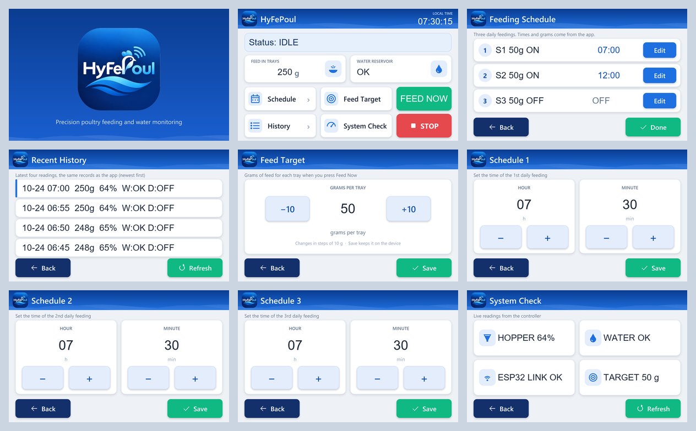

# HyFePoul Nextion design kit

A restyle of the onsite panel (NX8048P070, 800x480) in the HyFePoul brand: the logo's blue header with the wave, white cards, large touch targets, green for go and red for stop, matching the phone app.



**It changes the look only.** No component is added, deleted or renamed, so every page and component ID the Mega uses stays the same, and the firmware needs no change. Fixed captions and button labels are drawn into the artwork. Fields the Mega writes (status, clock, grams, water, schedules, history rows, readouts and the Feed Now label) stay live text, placed on the new cards.

## Contents

| Path | What it is |
|---|---|
| [`GUIDE.md`](GUIDE.md) | Step-by-step instructions for Nextion Editor, with every component's new position, size, pictures and colours |
| `mockups/` | How each page will look, with sample live values (`all-pages.png` is the overview) |
| `images/` | The 18 pictures to import: a *normal* and a *pressed* background per page, plus the splash |
| `layout.json` | The current layout read from the `.hmi` (pages, components, IDs, positions) |
| `spec.json` | The new layout the images and the guide are built from |
| `tools/read_hmi.py` | Reads the layout out of a `.hmi` (read-only) |
| `tools/make_design_kit.py` | Draws the images and mockups from the page layouts |
| `tools/make_guide.py` | Writes `GUIDE.md` from `spec.json` |

## How the panel uses the pictures

Each page shows its *normal* picture as the background. Each button uses "crop image": it shows its own area of the *normal* picture, and of the *pressed* picture while touched, so every button gets a pressed look without extra pictures per button. Live text is drawn by the panel on top of the background (also "crop image", so it has no box behind it).

## Changing the design

Edit the page layouts or colours at the top of `tools/make_design_kit.py`, then run:

```
python Nextion/design-kit/tools/make_design_kit.py
python Nextion/design-kit/tools/make_guide.py
```

If the `.hmi` itself changes (components added or moved by hand), run `tools/read_hmi.py` first and update the layouts to match; the page/component IDs in `spec.json` must equal those in `layout.json`.

Requires Python with Pillow, and the Windows Segoe UI and Arial fonts.
